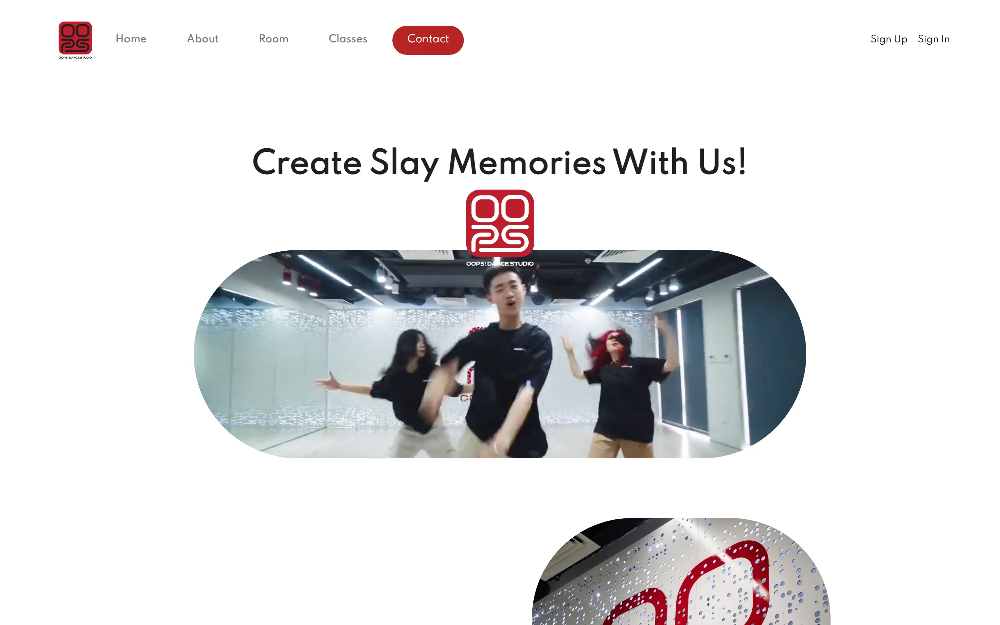
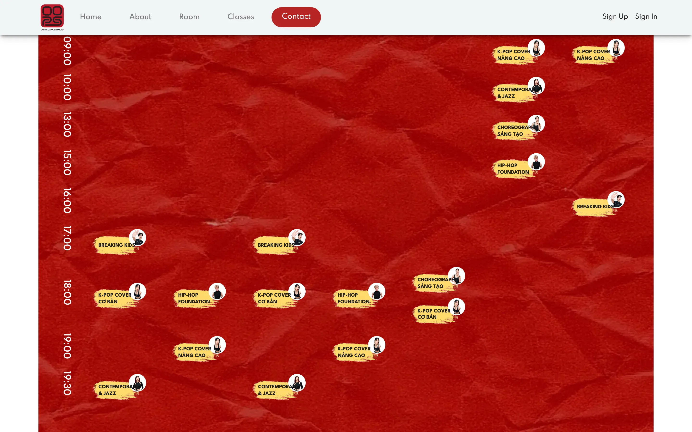
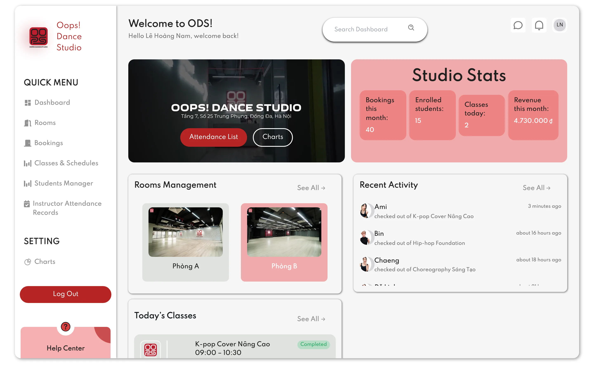
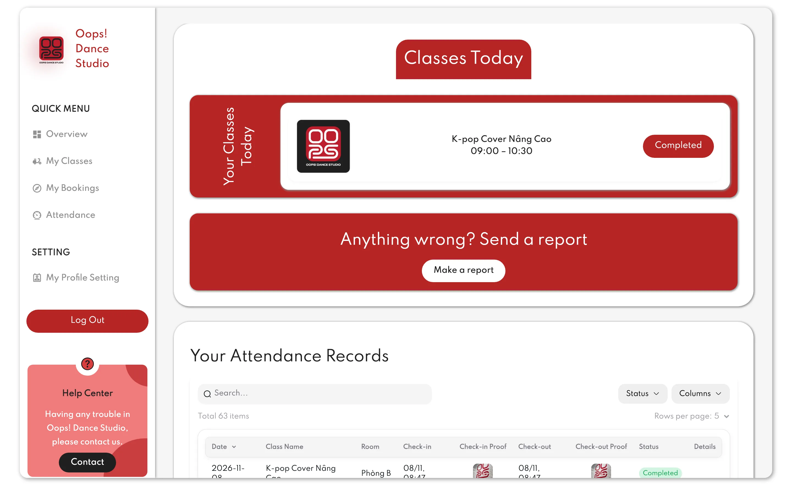
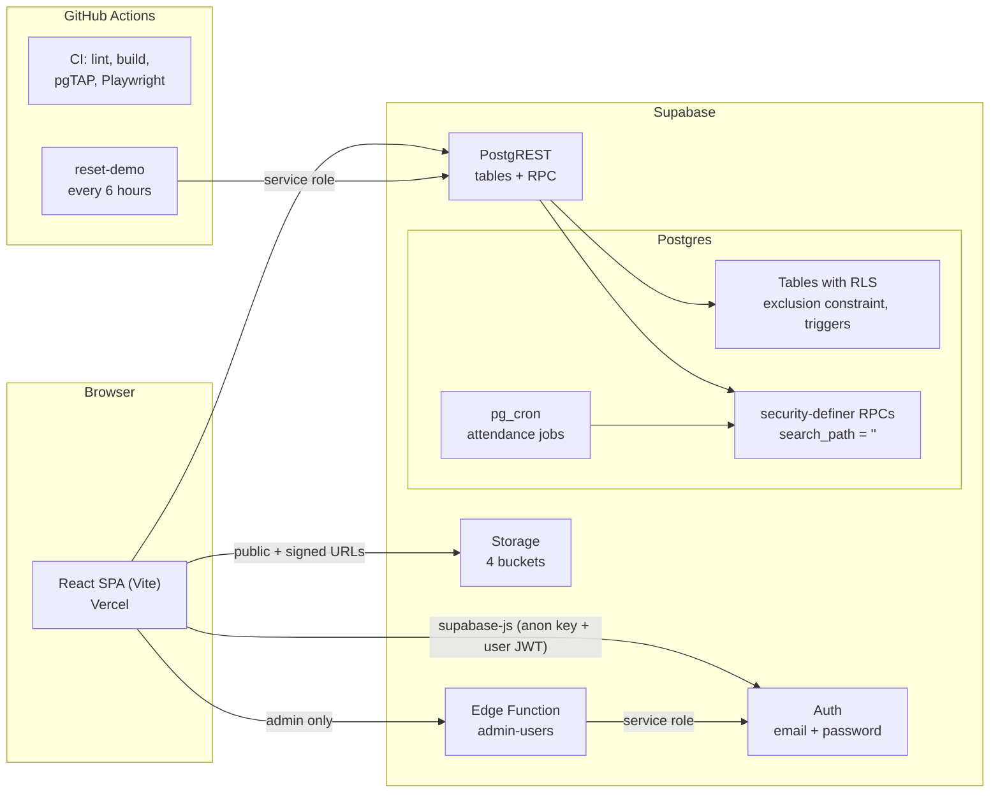

# Oops! Dance Studio

[](https://github.com/cookingminh/oops-dance-studio/actions/workflows/ci.yml)

A management app for a dance studio in Hanoi: visitors book rehearsal rooms, instructors check in with a photo, staff run the studio from a back office. Rebuilt from Django onto Supabase with row-level security, Postgres functions and end-to-end tests.

## Live demo

**Coming soon:** the demo is being deployed.

Use the one-click buttons on the login page. The demo runs on fake data and resets every 6 hours.

| Role | Account | Try this |
|---|---|---|
| Admin | `admin@demo.oopsdance.test` | Create a user, change a role, look at the revenue charts |
| Staff | `staff@demo.oopsdance.test` | Add a booking that overlaps another one, move a class to a busy room |
| Instructor | `instructor@demo.oopsdance.test` | Check in to today's class with a photo, then check out |
| Guest | `guest@demo.oopsdance.test` | Book a room from the homepage, then cancel it in My Bookings |

Demo accounts can't change their password or email, so the next visitor can still log in.

## Screenshots

| | |
|---|---|
|  |  |
| Public homepage | Weekly timetable, built from `class_schedules` |
|  |  |
| Staff dashboard: live stats, rooms, recent check-ins | Instructor: today's class and attendance records with photo proof |

## Features by role

| Role | What they can do |
|---|---|
| Visitor | Browse classes and the weekly timetable, search free rooms for a date and time range, sign up |
| Guest | Book a room (price computed by the server), cancel a pending booking, see enrolled classes and own attendance |
| Instructor | See today's sessions, check in and out with a proof photo, see own classes and students |
| Staff | Dashboard, rooms, bookings with payments, classes and schedules, enrolments, roll calls, instructor attendance, charts |
| Admin | Everything staff can do, plus create and delete users, change roles and login emails |

Access is enforced twice: route guards in the React app, and row-level security plus role checks in Postgres. The role always comes from the database, never from the client.

## Architecture



- **frontend/**: React 18, Vite, Tailwind, NextUI. Components never touch Supabase directly; they call `src/services/*`, which map database errors to stable codes such as `SLOT_TAKEN`. [Frontend README](frontend/README.md)
- **supabase/**: 9 migrations, 6 pgTAP test files, the `admin-users` Edge Function and a local seed. [Backend README](supabase/README.md)
- **scripts/**: seeds the hosted demo through the admin API and uploads the demo photos.
- **docs/architecture/**: the [API contract](docs/architecture/api-contract.md) both halves are built against, and the [mapping](docs/architecture/frontend-mapping.md) of every legacy API call to its replacement.

## Key engineering decisions

**Row-level security, deny by default.** RLS is on for every table, and anything a policy doesn't grant is refused. Anonymous users have no table privilege on profiles, bookings or attendance, so they get `permission denied`, not an empty list. Policies are written per role (guest, instructor, staff, admin), and a pgTAP matrix checks every role against every table.

**The database prevents double booking.** A `btree_gist` exclusion constraint rejects two live bookings for the same room whose time ranges overlap:

```sql
constraint bookings_no_overlap exclude using gist (
  room_id with =,
  tsrange(date + start_time, date + end_time, '[)') with &&
) where (status in ('pending', 'approved'))
```

Two people clicking "Book" at the same moment can't both succeed, whatever the client does. Back-to-back bookings (10:00–12:00, then 12:00–13:00) are allowed. A trigger extends the same rule to class timetables: a class session can't overlap a live booking in its room, and a class can't move into a room that is booked at its times.

**The server sets prices, check-in times and the time grid.** `create_booking` computes `full_payment = room price × hours` and the 50 % deposit itself; the legacy client sent the amounts. Instructor check-in and check-out timestamps come from `now()` inside the RPC, never from the device clock. Bookings must start and end on a 30-minute grid (`HH:00` / `HH:30`), between 08:00 and 22:00. A check constraint enforces this, and a trigger reports it as `INVALID_INPUT` so the UI can explain it.

**pg_cron instead of Celery.** Weekly instructor sessions and daily roll calls are generated by two `pg_cron` jobs that call idempotent SQL functions (`0` rows = already generated). There is no worker, broker or beat process to deploy, and staff can run the same functions from the UI.

**Security-definer RPCs with a locked `search_path`.** Every function runs with `set search_path = ''` and fully qualified names, so a caller can't shadow a table or operator. Each function checks the caller's role itself. Execute is revoked from `public` and `anon`, and a pgTAP test pins the exact list of functions anonymous users may call: `get_available_slots`, `list_public_classes`, `is_username_available` and `studio_today`. Internal helpers live in a `private` schema that the API doesn't expose.

## Testing

| Suite | Count | What it covers |
|---|---|---|
| pgTAP (`supabase test db`) | 195 | RLS matrix per role, available slots (Sunday/Monday, merging, opening hours), bookings, attendance generation, admin and stats RPCs, timetable clashes, the demo-reset guard |
| Playwright (`frontend/e2e`) | 101 | 93 browser flows across every role, auth and clash cases, plus 8 for the public demo build |
| Deno (`admin-users`) | 7 | demo-account protection, CORS allow-list, auth errors |

[CI](.github/workflows/ci.yml) runs all three on every push against a fresh local Supabase stack, plus ESLint and a production build. [gitleaks](.github/workflows/secrets.yml) scans the full git history on every push.

## v2 rewrite: what I found and fixed

The first version was a Django REST backend. Moving it to Supabase meant reading every view, and that review turned up these bugs:

- **A permissions override exposed every user.** `@permission_classes([AllowAny])` on class-based views replaced their real permission classes, so anonymous requests could read, edit and delete any user and booking. Now access is decided by RLS, which refuses by default.
- **Anyone could sign up as staff.** The sign-up endpoint accepted a `role` field. Now a trigger always creates a `guest`, and only an admin can change a role.
- **Room availability checked the wrong weekday.** `strftime('%w')` (Sunday = 0) was compared with schedules where Monday = 0, so classes blocked the wrong day. Weekdays are now ISO (1 = Monday … 7 = Sunday) everywhere, with tests for Sunday and Monday.
- **The attendance job never ran.** The Celery beat entry pointed at `your_app.tasks…`, and the task also crashed when there were no classes. It is now a `pg_cron` job calling a tested, idempotent SQL function.
- **A secret had leaked.** One was committed to the old public repositories. Instead of rewriting history, it was rotated by abandoning the service it belonged to. This repository starts from a fresh history.

## Run it locally

Prerequisites: Docker, [Supabase CLI](https://supabase.com/docs/guides/local-development/cli/getting-started) 3.x, Node 20.12+.

```bash
supabase start                              # Postgres, Auth, Storage, Edge Functions; applies migrations + seed
(cd scripts && npm ci) && node scripts/demo-images.mjs --local   # demo photos
supabase status                             # copy the API URL and anon key

cd frontend
cp .env.example .env.local                  # paste VITE_SUPABASE_URL / VITE_SUPABASE_ANON_KEY
npm ci
npm run dev                                 # http://localhost:5173
```

Sign in with any demo account from the table above; the local password is in the [backend README](supabase/README.md#demo-logins-local-seed).

Tests: `supabase test db` (pgTAP), and `npm run test:e2e` in `frontend/` (Playwright). Deploying your own copy is described in the [backend README](supabase/README.md#deploy-to-a-hosted-project).

## Follow-ups

- Upload and reorder room photos from Bookings → Rooms & prices (the database and storage paths already support it).
- Upgrade NextUI 2.4 to HeroUI.
- UI polish: the login page layout on wide screens, decorative dashboard widgets, placeholder footer links.
