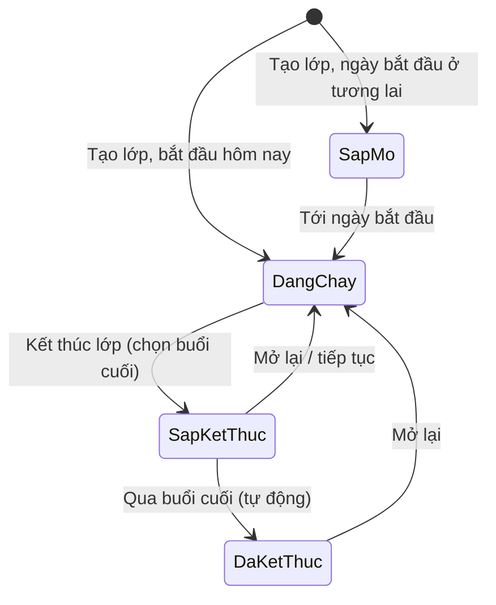
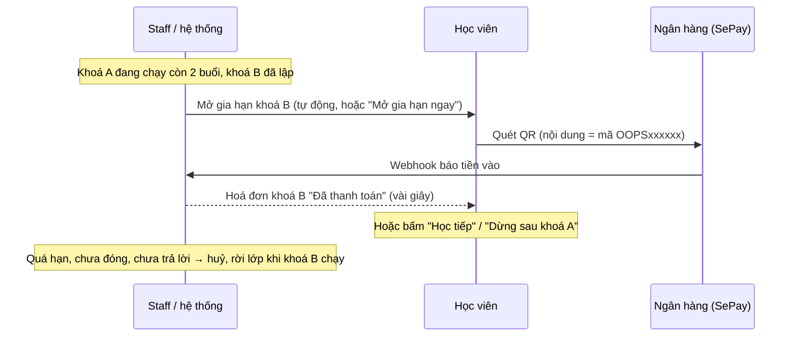

# Oops! Dance Studio — Các luồng vận hành

Tài liệu này mô tả **cách studio vận hành trên hệ thống**: lớp học, khoá (bài nhảy), học phí, chuyển lớp, điểm danh,
lương, chi phí và báo cáo. Viết cho chủ studio và staff; phần cuối có các mốc kỹ thuật cho người phát triển.

> Chi tiết kỹ thuật (bảng, quyền, hàm): [`docs/architecture/api-contract.md`](../architecture/api-contract.md).
> Cách chạy, deploy: [`supabase/README.md`](../../supabase/README.md), [`frontend/README.md`](../../frontend/README.md).

---

## 1. Ai dùng gì

| Vai trò | Vào đâu | Làm gì |
|---|---|---|
| Khách (chưa đăng nhập) | `/home`, `/classes`, `/rooms`, `/about` | Xem lớp, lịch tuần, video cuối khoá, tìm phòng trống, đăng ký tài khoản |
| Học viên (`guest` có lớp) | `/profile` | Lớp của tôi, học phí (đóng bằng QR), gia hạn/dừng khoá, điểm danh, đặt phòng |
| Giáo viên | `/profile` | Check-in/out có ảnh, lớp đang dạy, bài đang dạy, danh sách học viên |
| Staff | `/admin` | **Lớp học** (trung tâm theo lớp), đặt phòng, học viên, chấm công giáo viên, học phí, chi phí của mình |
| Admin | `/admin` | Mọi thứ của staff + người dùng, lương, báo cáo tài chính, cài đặt thanh toán, toàn bộ chi phí |

Ngôn ngữ: nút **EN / VI** ở thanh trên cùng, áp dụng cho toàn bộ app.

---

## 2. Lớp học — trung tâm theo lớp (`/admin/classes`)

Mọi thứ của một lớp nằm ở **một trang**: bấm vào lớp trong danh sách.

- **Danh sách lớp**: tab *Hôm nay* (lớp học hôm nay, check-in, điểm danh), *Tháng này* (lớp đang chạy + chỉ số),
  *Sắp tới* (lớp sắp mở), *Đã qua* (lớp đã kết thúc), *Lịch học* (thời khoá biểu tuần). Nút **Lớp mới**.
- **Trang một lớp** — các tab:
  1. **Tổng quan**: học viên, đã đóng tiền trong khoá này, số buổi, tỉ lệ điểm danh, lãi gộp (admin), buổi tiếp theo,
     việc cần làm của lớp, bài đang học.
  2. **Học viên**: thêm (từ khoá đang chạy hoặc từ khoá sắp tới), xoá, chuyển lớp, thu tiền, "vào lớp ngày…" /
     "rời lớp sau…".
  3. **Buổi học & điểm danh**: lịch tháng / tuần các buổi (thường + học bù); bấm một buổi để xem check-in/out kèm
     ảnh, duyệt, huỷ, **dạy thay**, điểm danh học viên.
  4. **Học phí**: chọn khoá trong **dropdown** (tên bài, ngày bắt đầu – kết thúc, số buổi, nhãn *Hiện tại / Sắp tới /
     Đã xong*; mặc định khoá đang chạy) → hoá đơn của khoá đó. Thẻ **Khoá tiếp theo** nói rõ: bắt đầu ngày nào, học
     phí bao nhiêu, học viên trả lời *học tiếp / nghỉ* trước hạn nào (ai chưa trả lời và chưa đóng đến hạn thì rời
     lớp); có 3 số đếm *Học tiếp · Nghỉ · Chưa trả lời*. Trước khi mở gia hạn: "Tự mở khi còn 2 buổi (ngày …)" + *Mở
     ngay*.
  5. **Bài nhảy**: khoá đang học, lập khoá tiếp theo, video, học bù.
  6. **Thu chi** (admin): học phí thu được, lương giáo viên, chi phí riêng của lớp, lãi gộp 6 tháng, mức lương/buổi.
     Phần **Thu chi theo ngày** là một **lịch tháng**: mỗi ngày hiện tiền vào (xanh), tiền ra (đỏ) và buổi học (kèm phòng
     nếu học ở studio thuê). Bấm một ngày → hộp thoại của ngày đó: **đổi phòng** cho buổi hôm đó (studio thuê đổi sang
     phòng khác → tiền thuê đã tính tự tính lại theo giá phòng mới), **sửa / xoá khoản chi** (ví dụ studio giảm giá thì
     sửa số tiền — đổi phòng sau đó sẽ tính lại theo giá phòng), **thêm khoản chi** cho đúng ngày đó (ví dụ mua nước),
     xem **học phí thu trong ngày**. Có nút chuyển sang dạng *Danh sách*. Khoản chi tự động (tiền thuê) chỉ admin thấy;
     staff thấy các khoản mình nhập.
  7. **Thiết lập**: thông tin, lịch tuần, ảnh, kết thúc / mở lại / xoá lớp.
- **Nơi học**: mỗi lớp học ở **một phòng của studio** (Phòng A, Phòng B) **hoặc một studio thuê ngoài** (ví dụ Studio
  Baladi Vũ Thạnh, Studio Thỏ, Quan Hoa, Hoàng Quốc Việt, Bà Triệu, Hoàng Ngân) — và nếu studio đó có nhiều phòng thì
  **một phòng của nó** (ví dụ Studio Thỏ · Phòng lớn; studio chỉ có một phòng thì tự vào phòng đó), chọn ở *Thiết lập*. Đổi nơi học thì các buổi chưa diễn ra đi theo.
- **Tên studio thuê không hiện ra ngoài** (đó là thương hiệu của studio khác): website và học viên chỉ thấy **tên hiển
  thị** — vị trí, ví dụ "Bà Triệu", "Đê La Thành nhỏ" — kèm địa chỉ và link bản đồ. Staff, giáo viên, admin thấy tên thật
  và phòng ("Studio Thỏ · Phòng lớn"). **Giá thuê chỉ staff/admin thấy**.
- **Studio thuê ngoài** (trang *Đặt phòng* → *Phòng & studio*): thêm / sửa tên, **tên hiển thị trên website** (để trống thì
  lấy phần đầu của địa chỉ), địa chỉ, link bản đồ, **các phòng** — studio nào cũng có ít nhất **một phòng**, mỗi phòng
  một giá thuê theo giờ; nhiều phòng thì thêm phòng — và ngưng dùng. Studio / phòng đã từng có lớp dạy thì chỉ ngưng dùng được, không xoá.
- **Tiền thuê tự thành chi phí**: mỗi buổi dạy ở studio thuê ngoài, khi buổi kết thúc → chi phí *Thuê studio ngoài* =
  giá/giờ **của phòng** × số giờ của buổi, gắn vào lớp (tính vào lãi của lớp và
  báo cáo). Hôm nào studio đổi phòng thì sửa ở *Thu chi* của lớp (bấm vào ngày đó). Buổi bị huỷ thì không tính (đã tính rồi
  mà huỷ sau thì tự xoá). Phòng A/B và đặt phòng giữ nguyên để dùng lại khi studio mở cửa lại.

### Lịch học trên website

Trang **Lớp học** của website (`/classes`) có lịch học trong tuần, với **hai kiểu** để chọn:

- **Poster** (mặc định): giống tờ lịch in của studio — các ngày xếp hàng ngang, mỗi lớp là một ảnh tròn của giáo viên
  trên nền màu theo **cấp độ** của lớp; chú thích màu nằm dưới lịch.
- **Nền đỏ**: kiểu đầu tiên — mỗi ngày một cột trên nền giấy đỏ, tên lớp trên nét cọ. Kiểu này không dùng màu cấp độ.

**Chọn kiểu** (staff và admin đều đổi được): *Lớp học* → tab *Lịch học* → ô **Trên website** ngay trên lịch tuần →
bấm vào kiểu muốn dùng. Lưu ngay, không cần bấm thêm; kiểu đang dùng có nhãn *Đang dùng*. Khách đang mở trang thì tải
lại là thấy kiểu mới. Link *Xem trên website* mở lịch học của website ở thẻ mới. Mỗi lần đổi được ghi vào *Activity*
(ai đổi, đổi sang kiểu nào, trước đó là kiểu nào).

**Cấp độ của lớp**: *Newbie* (đỏ), *Cơ bản* (nâu), *Nâng cao* (vàng) hoặc *Chưa có cấp độ* (xám). Chọn ở ô **Cấp độ**:

- khi tạo lớp (*Lớp mới*, bước đầu tiên);
- ở trang lớp → tab *Setting* → khung *Chi tiết* → *Lưu thông tin*;
- hoặc ⋮ trên đầu trang lớp → *Sửa thông tin*.

Cấp độ hiện thành nhãn nhỏ trên thẻ lớp trong danh sách lớp và quyết định màu của lớp trên lịch Poster. Lớp chưa chọn
cấp độ hiện màu xám trên Poster.

**Ảnh của lớp trên website**: trang lớp → tab *Setting* có hai khung **Ảnh** và **Ảnh trên lịch học**. Mỗi khung mở một
hộp thoại: bên trái chọn ảnh và căn chỉnh, bên phải là **bản xem trước y như trên website**. Kéo ảnh ngay trong bản xem
trước, hoặc dùng các thanh trượt; *Đặt lại* đưa về mặc định. Chưa bấm **Lưu** thì website chưa đổi gì (*Đóng* là bỏ).

- **Ảnh** (ảnh lớp, thường là poster dọc) → *Đổi ảnh*. Thẻ lớp ở trang *Lớp học* chỉ hiện một khúc ngang của ảnh; ô
  **Vị trí** chọn khúc nào (*Trái – phải*, *Lên – xuống*). Ví dụ muốn thấy tên lớp ở đầu poster thì kéo ảnh xuống. Poster
  dọc chỉ dịch lên – xuống (thanh *Trái – phải* bị khoá vì ảnh đã hiện hết chiều ngang). Bản xem trước là đúng thẻ lớp
  của website, với tên, giáo viên, bài đang học, giờ học, nơi học và học phí. *Lưu* tải ảnh mới lên (nếu có chọn) và lưu
  vị trí. Ảnh nhỏ trong danh sách lớp, đầu trang lớp và trang lớp của học viên / giáo viên cũng cắt theo vị trí này.
- **Ảnh trên lịch học** (ảnh tròn trên lịch Poster) → *Tải ảnh lên* / *Đổi ảnh*. Mỗi lớp có thể có ảnh riêng, thường là
  ảnh giáo viên đã tách nền; cùng một giáo viên có thể dùng ảnh khác nhau cho từng lớp. Lớp chưa có ảnh riêng thì lịch
  dùng **ảnh đại diện** của giáo viên (khung ghi *Đang dùng ảnh đại diện của …*). Đẹp nhất là ảnh PNG nền trong suốt,
  khuôn mặt ở giữa. Chỉnh **Thu phóng** (50–300 %), *Trái – phải*,
  *Lên – xuống*, hoặc kéo ảnh trong vòng tròn cho khuôn mặt nằm giữa; bản xem trước là vòng tròn đúng màu cấp độ, tên lớp
  và giờ học như trên Poster. *Gỡ ảnh* đưa lịch về lại ảnh đại diện (bấm *Lưu* mới gỡ thật).
- Ảnh cũ bị thay hoặc gỡ được xoá khỏi kho ảnh. Mỗi lần lưu được ghi vào *Activity*, ví dụ "… đã sửa lớp Trending ·
  Đã đổi: Vị trí ảnh lớp".

### Vòng đời một lớp



- **Lớp sắp mở**: nhận học viên đăng ký trước; học phí tính từ khoá đầu tiên; chưa có buổi học, chưa điểm danh.
- **Kết thúc lớp**: chọn buổi cuối (hôm nay / cuối tháng / ngày khác) và lý do.
  - Ngay lập tức: hoá đơn **chưa đóng** của các khoá sau buổi cuối bị huỷ; buổi học, điểm danh sau đó bị xoá.
  - Ai **đã lỡ đóng** cho khoá sau ngày kết thúc → hệ thống liệt kê để staff **chuyển lớp** (tiền đi theo) hoặc hoàn tiền.
  - Hôm sau buổi cuối (tự động 00:02): lớp không chiếm phòng nữa, rời thời khoá biểu, học viên ra khỏi lớp. **Lịch sử giữ nguyên.**
- **Xoá lớp** chỉ được khi lớp **chưa có lịch sử** (chưa dạy buổi nào, chưa điểm danh, chưa thu tiền) — tức là tạo nhầm.
  Lớp đã có lịch sử thì **kết thúc** thay vì xoá.

---

## 3. Khoá học = một bài nhảy, tính theo số buổi

Mỗi **khoá** là một bài: *tên bài*, *số buổi* (mặc định 8), *ngày bắt đầu*, *học phí khoá* (mặc định = giá lớp).

- Hệ thống đếm buổi theo **lịch tuần** của lớp, và tính **ngày học buổi cuối = ngày quay video**.
- **Huỷ một buổi** → buổi đó không tính → ngày kết thúc **lùi** thêm một buổi.
- **Học bù**: thêm một buổi vào một ngày lớp *không* học, có giờ riêng (08:00–22:00, kiểm tra trùng phòng với đặt
  phòng, lớp khác, buổi bù khác). Buổi bù có điểm danh, được tính lương khi hoàn thành, và **kéo ngày kết thúc sớm lại**.
- **Dạy thay**: đổi giáo viên cho đúng một buổi (tab Buổi học); lương buổi đó tính cho người dạy thay.
- **Mỗi lúc chỉ một bài**: bài tiếp theo bắt đầu **sau buổi cuối (ngày quay)** của bài đang học. Form *Lên bài nhảy
  tiếp theo* tự gợi ý buổi học đầu tiên sau ngày quay, không cho chọn ngày sớm hơn, và nói rõ học viên của bài đang
  học sẽ được hỏi có học tiếp không. Sửa một bài cũng vậy: không bắt đầu trước khi bài trước xong, không kéo dài sang
  bài sau. Server cũng chặn (`INVALID_STATE: routine order`).
- Khi khoá đang học **còn ≤ 2 buổi** mà chưa có khoá tiếp theo → việc cần làm "**Chọn bài tiếp theo**" (bấm vào là mở
  thẳng tab Bài nhảy của lớp đó).
- Cuối mỗi khoá: quay video, dán **link YouTube** vào khoá (tab Bài nhảy) → video hiện ở trang `/classes` (phần
  "lên hình") và trong trang lớp của học viên.

### Promo bài tiếp theo (staff / admin đăng)

Khi studio đã lên **bài tiếp theo** cho lớp, studio đăng một **clip promo** ngắn (15–60 giây: một đoạn nhảy và vài lời
giới thiệu) để học viên biết sắp học gì và quyết định học tiếp, còn khách biết lớp sắp học bài nào. Giáo viên không cần
làm gì trên app: trang của giáo viên không còn khối promo hay lời nhắc quay promo.

- **Nơi làm**: staff / admin vào lớp → tab **Bài nhảy** → dòng promo của bài sắp tới → *Tải lên*. Có hai cách:
  - **Dán link YouTube** (cách thường dùng): Shorts hay video thường đều được; để chế độ *công khai* hoặc *không công
    khai* (không để *riêng tư*). Không tốn dung lượng của studio, không giới hạn độ dài.
  - **Tải clip lên**: MP4/MOV/WebM, tối đa 50 MB (khoảng 1 phút), tối đa 3 phút. Hệ thống kiểm tra clip phát được,
    lấy một khung hình làm ảnh bìa, có thanh % khi tải lên.
  - Thêm **một câu gửi học viên** (không bắt buộc, ≤ 200 ký tự). Sau đó có thể *Thay*, *Gỡ*.
- **Nên đăng trước khi mở gia hạn** khoá mới (khi khoá đang học còn 2 buổi) — lúc học viên được hỏi có học tiếp không.
- **Ai xem**: học viên của lớp (trang lớp: *Bài tiếp theo* + nút *Xem promo*; trang Học phí: nút *Xem promo* ngay cạnh
  câu hỏi "Học tiếp khoá …?"), khách ở trang `/classes` (phần **Bài tiếp theo**, kèm nút *Nhận buổi học miễn phí*).
  Trang công khai hiện promo của bài sắp tới, và bài vừa bắt đầu trong 7 ngày.
- **Nhắc việc**: tab *Bài nhảy* của lớp hiện promo của từng bài (ai đăng, ngày, xem/thay/gỡ); chuông việc cần làm của
  staff nhắc "*Lớp X chưa có promo cho bài tiếp theo*" khi bài mới bắt đầu trong 14 ngày.
- **Dọn dẹp**: mỗi lớp chỉ giữ promo của bài đang học và bài sắp tới; khi đăng promo mới, file promo của các bài đã
  xong tự bị xoá. Xoá một bài cũng xoá clip promo của bài đó.

---

## 4. Học phí — thu theo khoá

**Trang *Học phí*** chỉ giữ việc chung của cả studio; chi tiết từng lớp nằm ở tab *Học phí* của lớp:
- Dòng tổng quan (đã thu / cần thu của các khoá đang chạy, còn nợ, số người trễ) + ô **tìm học viên hoặc mã `OOPS…`**
  (cả mã đặt phòng) + menu ⋯ (*Xuất CSV*, *Chạy kiểm tra hôm nay*, *Cài đặt thanh toán* cho admin).
- **Việc cần làm**: *Trễ hạn* (thu tiền, mã QR, ghi chú ngay trên dòng) → *Chuyển khoản cần xử lý* (gán cho học phí
  hoặc lượt đặt phòng, để riêng) → *Tiền dư* → *Sắp đến hạn* (thu gọn). *Lịch sử chuyển khoản* mở ở ngăn bên.
- **Theo lớp**: mỗi lớp một dòng — khoá đang chạy (đã đóng x/y, còn nợ) và khoá tiếp theo (học tiếp / chưa trả lời,
  hạn trả lời) → bấm để mở tab Học phí của lớp.



**Quy tắc**

| Tình huống | Hệ thống làm gì |
|---|---|
| Học viên **mới** vào lớp khi khoá **chưa bắt đầu** | Hoá đơn **đủ** học phí khoá đó |
| Học viên **mới** vào **giữa khoá** | Chỉ đóng **phần buổi còn lại** (ví dụ còn 5/8 buổi → 5/8 học phí, làm tròn 1.000 ₫). Staff sửa được số tiền |
| Học viên **cũ học tiếp** | Đóng **đủ** khoá mới |
| Khoá đang chạy **còn ≤ 2 buổi** và đã có khoá sau | **Mở gia hạn**: cả lớp nhận hoá đơn khoá sau (staff mở sớm được) |
| Hạn đóng / trả lời | Trước **buổi thứ 2** của khoá mới (ít nhất 3 ngày sau khi mở) |
| Quá hạn, **chưa đóng và chưa trả lời** | Hoá đơn huỷ (*không gia hạn*); học viên **rời lớp** khi khoá đó chạy |
| Đã trả lời **"Học tiếp"** nhưng chưa đóng | Vẫn ở lớp, chỉ bị đánh dấu **quá hạn** để staff nhắc |
| **Dừng** khoá sắp tới | Học nốt khoá đang học, rời lớp khi khoá sau bắt đầu |
| **Bỏ ngang giữa khoá** | **Không hoàn tiền**. Staff xoá khỏi lớp; điểm danh chưa chấm từ hôm nay bị xoá |
| Đóng muộn một khoá đã bị huỷ (nếu khoá chưa xong) | Tự **khôi phục** hoá đơn và cho học viên vào lại lớp |

Các con số "2 buổi", "buổi thứ 2", "tính theo buổi còn lại" chỉnh ở **Học phí → Cài đặt thanh toán** (admin).

**Cách đóng tiền**

- **Chuyển khoản QR**: học viên vào *Học phí* → *Đóng ngay* → quét VietQR (đúng số tiền + mã `OOPS…`). Ngân hàng báo
  qua **SePay webhook** → hoá đơn tự chuyển "Đã thanh toán". Chuyển thiếu → ghi nhận một phần; thừa → ghi chú.
- **Tiền mặt**: staff bấm *Ghi nhận thanh toán* trên dòng hoá đơn (số tiền, ghi chú). Có *Hoàn tác* nếu bấm nhầm.
- **Ghi chú**: menu ⋮ của mỗi khoản → *Thêm / Sửa ghi chú* (vd. "Hẹn đóng tiền mặt cuối tuần", "Đã nhắc qua Zalo").
  Ghi chú hiện ngay dưới dòng học viên; để trống là xoá.
- **Miễn / giảm**: *Miễn học phí khoá này* (kèm lý do) hoặc *Đổi số tiền* (giảm giá, ghi chú). *Mở lại* một khoản đã
  miễn → về "chưa đóng", lý do miễn biến mất, ghi chú trước đó (nếu có) quay lại.
- **Hộp thư chuyển khoản** (trang Học phí): tiền vào **không có mã** → hệ thống gợi ý hoá đơn khớp (cùng số tiền, có tên
  học viên/lớp trong nội dung) → staff *Gán*, hoặc *Bỏ qua* (ví dụ tiền cọc phòng).
- **Tiền dư**: khoản đã đóng mà nhận **nhiều hơn học phí** (chuyển khoản to hơn khoá, gán nhầm khoá, đổi lớp) hiện nhãn
  *Dư … ₫* dưới số tiền, nằm trong nhóm *Tiền dư* của Việc cần làm, và chuông nhắc. Bấm nhãn để:
  - *Chuyển sang khoá khác*: chọn một khoá **chưa đóng** của học viên, số tiền điền sẵn phần vừa đủ;
  - *Trả lại học viên*: tiền mặt hoặc chuyển khoản, kèm ghi chú.
  Báo cáo chỉ tính phần studio giữ lại. **Gán nhầm khoá** thì bấm *Huỷ khoản đã thu*: chuyển khoản về lại hộp thư để
  gán lại (tiền dư đã chuyển đi cũng được thu về; đã trả lại cho học viên thì không huỷ được nữa).
- **Demo / máy local** là "sandbox": tài khoản ngân hàng giả, mã QR có dải **DEMO**, nút **Giả lập chuyển khoản**.

---

## 5. Chuyển lớp — chỉ giữa hai khoá

Không chuyển lớp giữa chừng, không hoàn tiền. **Học viên đăng ký khoá sắp khai giảng của lớp mới**; lớp cũ tự xử lý.

1. Staff mở hộp thoại **Chuyển lớp** (trang lớp → Học viên, trang Học phí, hoặc hồ sơ người dùng).
2. Chọn lớp mới → hệ thống chọn **khoá sắp bắt đầu** của lớp đó (từ hôm nay trở đi). Nếu lớp mới chưa có khoá nào sắp
   tới → phải **lập khoá trước**.
3. Kết quả:
   - Lớp mới: học viên vào lớp **từ ngày khoá mới bắt đầu**, hoá đơn **đủ** học phí khoá đó.
   - Lớp cũ: học **nốt khoá đang học** (đã đóng, không hoàn), **rời lớp sau buổi cuối** (tự động).
   - Nếu đã **lỡ đóng trước** khoá sau của lớp cũ → khoản đó huỷ và **tiền chuyển sang** khoá mới.
4. Báo cáo: học viên vẫn tính là **học tiếp**; số lượt chuyển lớp đếm riêng.

Ví dụ (dữ liệu demo): *Lê Khánh Linh* học nốt "Super Shy" ở K-pop Cơ Bản (đến 18/11), vào K-pop Nâng Cao từ
"Armageddon" (bắt đầu 15/11), đóng 1.200.000 ₫.

---

## 6. Điểm danh

- **Giáo viên**: `/profile` → *Check-in* → chụp ảnh lúc vào và lúc ra. Buổi học bù hiện giờ riêng và nhãn *Học bù*.
  - **Check-in** mở từ **15 phút trước** giờ học tới hết buổi; quá giờ kết thúc thì báo studio ghi nhận.
  - **Check-out** được ngay (về sớm cũng được); muộn hơn **10 phút sau giờ kết thúc** vẫn check-out được nhưng buổi
    bị gắn nhãn **Check-out muộn**.
  - Staff **sửa giờ check-in/out** (và nhãn muộn) trong cửa sổ buổi học, bắt buộc ghi lý do; nhật ký hoạt động lưu
    giờ trước và sau khi sửa.
- **Một trang *Điểm danh*** (`/admin/attendance`) gộp điểm danh học viên và chấm công giáo viên. Hai trang cũ
  (*Học viên*, *Chấm công giáo viên*) tự chuyển về đây.
  - **Hôm nay** (truy cập nhanh): mọi buổi hôm nay theo giờ, có check-in/out kèm ảnh, số học viên đã điểm danh x/y, và
    nút *Điểm danh*, *Đánh dấu hoàn thành*, *Huỷ*. Buổi học và danh sách điểm danh **tự có** (xem §13); chỉ khi còn
    thiếu (dữ liệu cũ, hoặc một buổi thêm vào sau giờ học hôm nay) mới hiện dòng nhắc kèm nút *Tạo bù*.
  - **Cần xem lại**: các buổi đã qua mà chưa ai chốt.
  - **Tất cả buổi học** dạng **lịch** (tuần / tháng), lọc theo giáo viên, lớp, trạng thái; nút *Danh sách* để tìm
    kiếm và xuất CSV.
  - Danh sách học viên của từng lớp nằm ở trang lớp (tab *Học viên*).
- **Bấm vào một buổi** (ở trang *Điểm danh* hoặc tab *Buổi học & điểm danh* của lớp, cũng dạng lịch) → cửa sổ buổi
  học:
  - giáo viên (đổi *dạy thay* cho buổi này);
  - check-in/out kèm ảnh;
  - *Đánh dấu hoàn thành* / *Huỷ buổi* / *Mở lại buổi*;
  - ghi chú;
  - điểm danh từng học viên.
  Buổi **hoàn thành** mới được tính lương.
- **Huỷ buổi** → phòng trống cho người khác đặt, và khoá đang học lùi thêm một buổi. **Mở lại** chỉ được khi chưa ai
  đặt phòng giờ đó; nếu đã có người đặt thì thêm buổi học bù.
- **Nghỉ / dời buổi** (bão, giáo viên ốm, phòng có sự cố…): mở buổi học → *Nghỉ / dời buổi*, làm được cả với buổi
  tuần sau.
  - Bắt buộc chọn hoặc ghi **lý do**; học viên sẽ thấy lý do này.
  - Chọn *Học bù vào ngày khác* (ngày, giờ; hệ thống kiểm tra phòng trống và ngày lớp không học) → một bước vừa nghỉ
    buổi cũ vừa tạo buổi học bù ghi rõ "học bù cho Thứ 4 …"; hoặc *Chỉ nghỉ*, xếp học bù sau từ chính buổi đã nghỉ.
  - Nếu đó là **buổi quay**: ngày quay tự chuyển sang buổi học bù (hoặc lùi sang buổi sau nếu chưa xếp bù).
- **Nghỉ cả ngày** (trang *Điểm danh*): mọi lớp hôm đó nghỉ với cùng một lý do; tuỳ chọn huỷ luôn các lượt đặt phòng
  hôm đó (studio huỷ → hoàn toàn bộ tiền cho khách). Sau đó xếp học bù cho từng lớp.
- **Học viên và giáo viên được báo**: lịch tuần của họ hiện buổi nghỉ (kèm lý do) và buổi học bù; chuông thông báo
  có mục *Lịch thay đổi*.
- **Điểm danh học viên**: mỗi ngày 00:05 hệ thống tạo danh sách cho các buổi hôm nay (kể cả học bù) → staff/giáo viên
  đánh dấu *Có mặt / Vắng*. Chuông thông báo nhắc lớp chưa điểm danh; bấm vào là mở thẳng buổi học đó.

---

## 7. Đặt phòng tập

- Khách tìm giờ trống ở `/rooms` (thanh giờ hiển thị các khoảng còn trống) → đăng nhập → đặt → chờ studio duyệt.
- Staff: *Đặt phòng* có ba chế độ **Lịch | Danh sách | Phòng & giá** (mặc định là lịch tuần / tháng; *Danh sách* để
  tìm kiếm). *Phòng & giá* thay cho trang *Phòng* cũ (`/admin/rooms` tự chuyển về đây): mỗi phòng có ảnh, tiện ích,
  **giá theo giờ** (sửa tại chỗ), số lượt đặt tuần này / tháng này, doanh thu tháng, lượt đặt tiếp theo và nút
  *Xem lịch phòng này* (mở lịch chỉ của phòng đó); **chính sách huỷ** nằm cạnh bảng giá.
  - Mỗi lượt đặt mang màu phòng. *Chờ duyệt* có viền nét đứt và nhãn vàng; chip **Chờ duyệt** lọc nhanh các yêu cầu
    cần xử lý.
  - Buổi học của các lớp hiện dạng sọc mờ phía sau, để biết vì sao giờ đó đã kín.
  - Bấm vào một lượt đặt → hộp thông tin: khách, phòng, giờ, tiền, cọc, ghi chú; duyệt / từ chối, sửa thanh toán, huỷ,
    xoá.
  - Bấm vào ô trống (tuần) → *Đặt phòng mới* điền sẵn phòng, ngày, giờ.
- **Thanh toán bằng QR** (như học phí): mỗi lượt đặt có **mã thanh toán** riêng (`OOPS…`).
  - Hộp lượt đặt phòng có phần *Thanh toán*: giá theo giờ × số giờ, cọc, đã nhận, còn phải trả.
  - Mã QR VietQR cho tiền cọc / phần còn lại / toàn bộ, kèm số tài khoản và **nội dung chuyển khoản** có mã.
  - Lịch sử từng khoản chuyển khoản (giờ, số tiền, nội dung) và **hoá đơn** in được.
  - Khách cũng thấy nút *Đóng cọc* / *Đóng phần còn lại* ở trang *Phòng đã đặt*.
  - Tiền về đúng mã → tự cộng vào lượt đặt, cọc tự chuyển *đã trả*.
  - **Trả nốt phần còn lại**:
    - chuyển khoản → QR *Phần còn lại*, tiền tự cộng;
    - tiền mặt (hoặc chuyển khoản mà hệ thống không tự thấy) → *Ghi nhận thanh toán*: số tiền điền sẵn phần còn lại,
      ghi rõ ai thu, lúc nào.
  - **Hoàn tiền lẻ** (trả lại một phần khi lượt đặt vẫn giữ): ở *Ghi nhận thanh toán* → chọn *Hoàn tiền*, bắt buộc
    ghi lý do. Hoàn tiền khi **huỷ** thì theo chính sách huỷ bên dưới.
  - **Đổi giá** (giảm giá, thêm / bớt giờ, phụ thu): *Đổi giá* → nhập tổng mới + **lý do** (bắt buộc), vd. "Khách
    quen giảm 10%". Giá gốc (giá phòng × số giờ) vẫn giữ. Hoá đơn ghi: *Giá gốc 375.000 → Khách quen giảm 10% →
    337.500*. Đổi giờ / đổi phòng thì giá tự tính lại, trừ khi giá đã chỉnh tay.
  - **Staff đặt hộ khách** (khách gọi điện / đến quầy): *Đặt phòng mới*.
    - Chọn khách, phòng, ngày, giờ. Giá tự tính (giá phòng × số giờ, cọc 50%); muốn đổi giá thì ghi lý do.
    - Trạng thái: *Đã duyệt* (mặc định) hoặc *Giữ chỗ (chờ duyệt)*.
  - **Trả đủ = Hoàn thành**: lượt *Đã duyệt* khi nhận đủ tiền (chuyển khoản, tiền mặt) tự chuyển sang *Hoàn thành*;
    nếu bị trả lại tiền trước ngày đặt thì quay về *Đã duyệt*. Lượt *Hoàn thành* chưa tới ngày vẫn giữ phòng, và
    vẫn huỷ được (hoàn tiền theo chính sách). Trên lịch, lượt đó hiện đậm với nhãn **Đã trả đủ**; *Đánh dấu hoàn
    thành* chỉ còn cho lượt đã diễn ra (xác nhận buổi đã thuê).
    - **Thu ngay**: *Chưa thu* (khách trả sau bằng QR) / *Cọc* / *Toàn bộ* / *Số khác*, bằng *Tiền mặt* hoặc
      *Chuyển khoản* (khách đưa màn hình chuyển khoản).
    - Lưu xong mở luôn lượt đặt: nếu chưa thu thì hiện QR có mã để gửi khách.
    - Mã thanh toán luôn được tạo tự động.
  - Các ô tiền không còn sửa tay trong form *Sửa lượt đặt*. Mọi khoản tiền đều có dòng trong lịch sử, và nhật ký
    hoạt động ghi ai làm.
  - Chuyển khoản thiếu hoặc sai mã nằm trong hộp *Chuyển khoản* (trang Học phí) → staff *gán cho lượt đặt phòng* (theo
    #số hoặc mã), hoặc *gỡ ra* nếu gán nhầm. Lượt đặt đã huỷ / bị từ chối thì tiền không tự cộng (để hoàn tiền).
- **Chính sách huỷ & hoàn tiền** (admin chỉnh ở thẻ *Chính sách huỷ* trong *Đặt phòng → Phòng & giá*; mặc định):
  - huỷ trước giờ đặt **từ 24 giờ trở lên** → hoàn **50%** số đã đóng; **dưới 24 giờ** → không hoàn;
  - có thể bật thêm mốc **hoàn 100%** (ví dụ huỷ trước 72 giờ);
  - lượt **chưa được duyệt**, hoặc **studio huỷ / từ chối** → hoàn toàn bộ.
  - Khách tự huỷ được cả lượt **đã duyệt** (trước giờ bắt đầu) ở trang *Phòng đã đặt*: trước khi xác nhận thấy rõ được
    hoàn bao nhiêu, và có thể ghi tài khoản nhận tiền. Chính sách cũng hiện khi đặt phòng.
  - Staff huỷ: chọn *Khách xin huỷ* (theo chính sách) hoặc *Studio huỷ* (hoàn hết); muốn hoàn số khác thì ghi lý do.
  - Số tiền cần hoàn nằm trên lượt đặt (*Cần hoàn …*) và trong chuông việc cần làm cho tới khi staff bấm *Đã hoàn*
    (chuyển khoản hoặc tiền mặt). Phần studio giữ lại được tính vào doanh thu.
- Lịch lớp và buổi học bù tự chặn phòng, nhưng chỉ trong thời gian lớp chạy. **Buổi lớp đã huỷ thì phòng trống** và
  có thể cho đặt; khi đó buổi huỷ không mở lại được nữa (báo trùng phòng).

---

## 8. Lương (admin — *Tính lương*)

- **Giáo viên**: số buổi **hoàn thành** × mức/buổi (mặc định 300.000 ₫; chỉnh riêng từng lớp).
- **Staff**: lương cố định hằng tháng.
- **Thưởng / phạt** có lý do (ví dụ check-in trễ, dạy thay).
- Cuối tháng: **Chốt** bảng lương (số liệu đóng băng) → **Đã trả**. Có thể mở lại khi chưa trả. Xuất CSV.
- **Phiếu lương** của giáo viên có **lịch tháng**:
  - mỗi buổi đã dạy là một ô theo màu lớp (giờ vào → ra, tiền buổi đó, nhãn *học bù / dạy thay / vào muộn*);
  - buổi huỷ / thiếu check-in hiện mờ *Không tính*, buổi chưa tới *Chưa tính*;
  - chú thích theo lớp khớp với các dòng tiền;
  - bấm một buổi để xem ảnh và điểm danh (phiếu còn *Đang tính* thì duyệt được ngay).

---

## 9. Chi phí (*Chi phí*)

- 12 nhóm: mặt bằng, điện nước/internet, quay dựng video, trang phục, thuê địa điểm quay, thiết bị, marketing, sự kiện,
  sửa chữa, vật tư, **thuê studio ngoài** (hệ thống tự ghi sau mỗi buổi dạy, xem mục 2), khác.
- **Gắn vào một lớp** khi là chi phí riêng của lớp (camera man quay lớp đó, trang phục lớp đó) → trừ vào lãi của lớp.
- **Ảnh/PDF hoá đơn** đính kèm.
- **Chi phí định kỳ** (tiền nhà, internet, quảng cáo): tự thêm vào đúng ngày mỗi tháng (00:15). Xoá bản của một tháng
  thì tháng đó không tự thêm lại.
- Staff ghi được **chi phí lặt vặt của mình** và chỉ thấy khoản của mình; admin thấy tất cả.

---

## 10. Báo cáo tài chính (admin — *Báo cáo*)

```
Doanh thu  = học phí đã thu (tính vào tháng khoá bắt đầu) + tiền thuê phòng (theo ngày đặt)
Chi phí    = lương (bảng lương tháng) + chi phí (theo ngày chi)
Lợi nhuận  = Doanh thu − Chi phí
Lãi của lớp = học phí lớp thu được − lương giáo viên dạy lớp − chi phí gắn riêng cho lớp
```

- Tiền mặt bằng, điện nước… là **chi phí chung**, chỉ tính ở cấp studio, không chia cho từng lớp.
- **Biến động học viên** đếm theo **người**: mới / học tiếp / quay lại / nghỉ; chuyển lớp **không** tính là nghỉ.
- Có thẻ "Lợi nhuận đến từ đâu", biểu đồ doanh thu, chi phí, lợi nhuận, cơ cấu thanh toán, bảng lãi theo lớp, mục
  "Điểm đáng chú ý", xuất CSV, in A4.

---

## 11. Việc cần làm & thông báo (chuông, staff/admin)

Hệ thống tự nhắc: yêu cầu đặt phòng chờ duyệt, check-in cần duyệt, lớp chưa điểm danh, lớp cần chọn bài tiếp theo,
bài sắp bắt đầu mà chưa có promo, học viên trễ học phí, chuyển khoản chưa gán, học viên chưa trả lời gia hạn khoá. Số đỏ cạnh mục menu là số việc.

---

### Nhắc học viên / khách đóng tiền

Ai đăng nhập vào `/profile` mà còn khoản cần đóng sẽ được nhắc ở ba chỗ:

- **Chuông thông báo** trên thanh trên cùng: liệt kê từng khoản (quá hạn → sắp đến hạn → sắp tới), mỗi khoản có nút
  **Đóng …** mở ngay mã QR chuyển khoản. Bấm vào dòng thì sang trang Học phí / Phòng đã đặt.
- **Số đỏ trên menu** *Học phí* và *Phòng đã đặt*.
- **Lời nhắc nhẹ** ở góc trang **Dashboard** (trang vào đầu tiên sau khi đăng nhập), **mỗi ngày một lần**, khi có
  khoản quá hạn hoặc đến hạn trong 3 ngày: một câu thân thiện, nút **Đóng …** (mở QR) và **Để sau** (hôm đó không hiện
  lại). Chỉ hiện ở Dashboard để không che nút của các form.

Những khoản được nhắc: học phí khoá đang học (hoặc đã xong) chưa đóng; khoá tiếp theo chưa trả lời (*Học tiếp
không?*) hoặc đã chọn học tiếp nhưng chưa đóng; tiền cọc của lượt đặt phòng sắp tới (lượt chờ duyệt: cọc xong
studio mới xác nhận); tiền phòng còn thiếu sau ngày đã đặt. Giáo viên chỉ được nhắc tiền phòng.

---

## 12. Nhật ký hoạt động (admin — *Activity*)

Ai làm gì, lúc nào. Mỗi thao tác của một người được ghi lại **tự động** (trigger trong database), nên không cần làm
gì thêm:

- **Đặt phòng**: khách gửi yêu cầu, nhân viên duyệt / từ chối / huỷ, sửa thanh toán.
- **Buổi dạy**: giáo viên check-in / check-out, nhân viên duyệt buổi, huỷ, mở lại, dạy thay, thêm buổi bù.
- **Điểm danh**: ai đánh dấu ai có mặt / vắng.
- **Học phí**: thu tiền (tiền mặt: tên nhân viên; chuyển khoản: "hệ thống"), miễn, mở lại, đổi số tiền, huỷ, học viên
  trả lời gia hạn, gán / bỏ qua chuyển khoản.
- **Lớp, bài nhảy, học viên**: tạo / sửa / kết thúc lớp, đổi lịch, lên bài, thêm video, xếp lớp, rời lớp.
- **Chi phí, lương, phòng, tài khoản, cài đặt**: thêm / sửa / xoá; chốt / trả phiếu lương; đổi vai trò; tạo / xoá tài khoản;
  đổi kiểu lịch học trên website.

Những dòng do hệ thống **tự tạo** (buổi dạy hằng tuần, danh sách điểm danh, hoá đơn) không ghi; việc tự động chỉ ghi
khi đáng biết: tiền về từ ngân hàng, hoá đơn bị huỷ do không trả lời gia hạn, học viên rời lớp sau khoá, có người tự
đăng ký tài khoản, chuyển khoản không khớp. Chỉ **admin** xem được. Lưu 400 ngày.

Trang *Activity* sắp theo ngày, gộp các thao tác liền nhau (vd. một lần điểm danh cả lớp thành một dòng), lọc theo
người / khu vực / thời gian, bấm vào một dòng để xem đã đổi gì và lịch sử của bản ghi đó.

---

## 13. Việc tự động mỗi ngày (giờ Việt Nam)

| Giờ | Việc |
|---|---|
| 00:00 thứ Hai | Tạo các buổi dạy trong tuần cho giáo viên |
| 00:02 | Lớp đã qua buổi cuối: giải phóng phòng, đưa học viên ra khỏi lớp |
| 00:03 | Cập nhật bài đang học của từng lớp |
| 00:05 | Tạo danh sách điểm danh hôm nay (kể cả học bù) |
| 00:10 | Học phí: lập hoá đơn khoá đang chạy, mở gia hạn khi còn 2 buổi, huỷ hoá đơn quá hạn chưa trả lời, đưa học viên rời lớp |
| 00:15 | Thêm chi phí định kỳ đến ngày |
| 00:20 | Tính tiền thuê studio ngoài cho các buổi đã dạy |
| 00:25 | Xoá nhật ký hoạt động cũ hơn 400 ngày |

**Tự cập nhật ngay khi có thay đổi** (không cần chờ tới giờ chạy, không cần bấm nút):
- Thêm / dời / xoá **buổi học hằng tuần** của lớp, hoặc đổi ngày khai giảng / ngày kết thúc của lớp → các buổi còn lại của
  **tuần này** đi theo ngay: buổi còn thiếu được tạo (từ bây giờ trở đi — ngày đã qua, hay buổi hôm nay đã tới giờ, thì
  không tạo); buổi không còn khớp lịch mà chưa ai đụng tới (chưa check-in, chưa điểm danh ai) thì bỏ. Tuần sau vẫn do việc
  00:00 thứ Hai tạo.
- **Thêm học viên** vào lớp có buổi hôm nay (chưa xong) → học viên có tên trong danh sách điểm danh hôm nay.
- Những thay đổi này không ghi thêm dòng nào vào trang *Hoạt động* (chỉ dòng của thay đổi gốc, ví dụ "thêm buổi học").

---

## 14. Đăng nhập

- Email + mật khẩu; quên mật khẩu → email đặt lại.
- **Google / Facebook**: bật được khi studio có OAuth app. Các bước (chi tiết trong `supabase/README.md`):
  1. Tạo OAuth client (Google Cloud Console) và Facebook Login app, redirect URI
     `https://<project>.supabase.co/auth/v1/callback`.
  2. Dán Client ID / Secret vào Supabase → Authentication → Providers.
  3. Thêm địa chỉ web vào Redirect URLs; đặt `VITE_AUTH_PROVIDERS=google,facebook` cho frontend.
- Người đăng ký bằng Google/Facebook là học viên mới; trang Tổng quan nhắc bổ sung số điện thoại.

---

## 15. Cài đặt cần làm một lần (admin / người triển khai)

1. **Tài khoản ngân hàng nhận học phí**: *Học phí → Cài đặt thanh toán* (mã ngân hàng/BIN, số tài khoản, tên).
2. **SePay** (để QR tự cập nhật): liên kết tài khoản ngân hàng studio → Webhooks → URL
   `https://<project>.supabase.co/functions/v1/bank-webhook`, xác thực API Key → chạy
   `supabase secrets set BANK_WEBHOOK_KEY=<key>` → `supabase functions deploy bank-webhook --no-verify-jwt`.
3. **Deploy CSDL**: `supabase db push --remote` (áp các migration mới), rồi deploy frontend.
   - **Ngay sau khi deploy**: vào *Lớp học* → từng lớp → tab **Bài nhảy**, kiểm tra **khoá đang học** (tên bài, số
     buổi, ngày bắt đầu, học phí khoá). Bài cũ theo tháng được chuyển thành khoá; lớp nào chưa có khoá đang chạy thì
     **chưa thu học phí** cho tới khi staff lập khoá. Ai đã đóng tiền mặt trước đó thì staff *Ghi nhận thanh toán*.
4. **Edge function `admin-users`**: deploy lại (`supabase functions deploy admin-users`) để nhật ký ghi đúng tên admin
   khi tạo / xoá tài khoản.
5. **Bản demo**: `node scripts/seed-demo.mjs --reset --i-know-this-wipes` (chỉ trên project đã đánh dấu demo).

---

## 16. Mốc kỹ thuật (cho người phát triển)

| Luồng | Migration | Hàm chính |
|---|---|---|
| Học phí theo khoá | `20261116000100_course_tuition.sql` | `bill_course`, `bill_class`, `tuition_run_cycle`, `tuition_open_course` |
| Chuyển lớp giữa khoá | `20261116000400_switch_after_course.sql` | `tuition_switch_class`, `class_students.leaves_after` |
| Vòng đời lớp | `20261114000100_class_lifecycle.sql` | `class_end`, `class_reopen`, `classes_run_endings` |
| Khoá theo số buổi, học bù | `20261115000100_routines.sql` | `lesson_progress`, `class_add_session` |
| Chi phí, lãi lỗ | `20261113000100_switch_and_expenses.sql` | `finance_monthly`, `finance_by_class`, `expenses_run_recurring` |
| Webhook ngân hàng | `supabase/functions/bank-webhook` | `tuition_record_transfer` |
| Mỗi lúc một bài, miễn → mở lại | `20261117000100_routine_order_and_waive.sql` | `check_routine_order`, `tuition_waive`, `tuition_reopen` |
| Nhật ký hoạt động | `20261117000200_activity_log.sql` | `log_activity`, `activity_summary`, `seed_demo_activity` |
| Promo bài tiếp theo | `20261117000700_routine_promos.sql` | `lesson_set_promo`, bucket `class-promos` |
| Nghỉ / dời buổi, nghỉ cả ngày | `20261117000900_session_changes.sql` | `session_cancel`, `session_move`, `studio_close_day`, `my_session_changes` |
| Khung giờ check-in, check-out muộn | `20261117001100_checkin_window.sql` | `instructor_check_in`, `instructor_check_out`, `session_edit_check` |
| Trả đủ = Hoàn thành | `20261117001000_booking_auto_complete.sql` | trigger `booking_auto_complete` |
| Huỷ đặt phòng & hoàn tiền | `20261117000800_booking_refunds.sql` | `cancel_booking`, `booking_cancel_quote`, `booking_refund`, `booking_settings` |
| Lịch học trên website, cấp độ lớp | `20261117001500_timetable_templates.sql` | `site_settings`, `site_set_timetable_template`, `classes.level`, `seed_demo_levels` |
| Vị trí ảnh lớp, ảnh tròn trên lịch học | `20261117001600_timetable_photos.sql` | `classes.image_pos_x/_y`, `classes.timetable_photo_path/_x/_y/_zoom`, `list_public_classes` |

Kiểm thử: `supabase test db` (pgTAP), `cd frontend && npx playwright test` (e2e).
